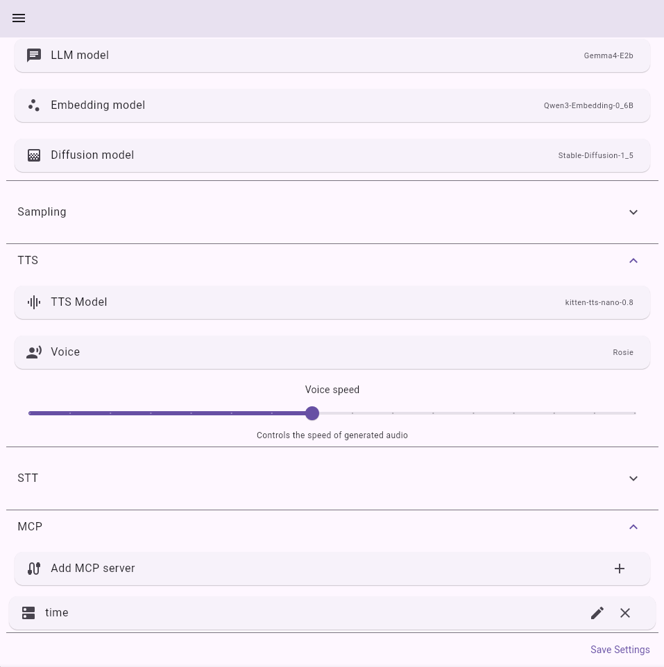

# Cognium

A local-first agentic platform.

<table>
    <tr>
        <td>
            
            <p align="center">Chat page</p>
        </td>
        <td>
            
            <p align="center">Configuration page</p>
        </td>
    </tr>
</table>

Cognium is a local-first AI assistant platform designed to run LLM inference, manage conversational context, and execute agentic workflows using locally hosted models and tools.

## Features

- Local LLM inference
- Chat history
- Streaming responses
- PostgreSQL integration
- Configurable inference parameters
- Attachments upload support
    - Raw text files
    - PDF (only text)
    - Image (PNG, JPG, JPEG)
    - Video (MP4; frame-based processing only)
- Tool calls support
    - Summarize
    - RAG
    - Web search
    - Web fetch
    - MCP tools (auto discovery and execution) [EXPERIMENTAL]
- Agentic capabilities
- LTM (Long-Term Memory) [EXPERIMENTAL]
- Image generation
- Text-to-Speech support
- Speech-to-Text support (Only on localhost)
- MCP protocol support (only stdio) [EXPERIMENTAL]

## `DATA` Directory Structure

```text
DATA
|-- Config
|    |-- config.json
|    |-- mcp_config.json
|-- Generated
|-- Models
|    |-- Embedding
|    |    |-- model_name
|    |        |-- model_name.gguf
|    |-- Image
|    |    |-- model_name
|    |        |-- model_name.gguf
|    |-- STT
|    |    |-- whisper.cpp
|    |        |-- checkpoint_name
|    |            |-- checkpoint_name.bin
|    |-- Text
|    |    |-- model_name
|    |        |-- model_name.gguf
|    |        |-- mmproj_model_name.gguf
|    |-- TTS
|        |-- Kitten
|-- Upload
```

- **Config**: Stores the application configuration.
    - **config.json**: Inference-related configuration.
    - **mcp_config.json**: Registry of MCP servers.
- **Generated**: Stores application-generated content.
- **Models**: Models directory.
    - **Embedding**: Embedding models directory (used in RAG tool).
    - **Image**: Image generation models (used on image_generation tool).
    - **STT**: Speech-to-Text related models.
    - **Text**: Text and multimodal LLM models.
    - **TTS**: Text-to-Speech related models (for now only KittenTTS blobs).
- **Upload**: User-uploaded files.

The `DATA` directory is automatically created, but a custom path can be configured using the `DATA_PATH` variable in `.env` file.

## `.env` Structure

- **`DATA_PATH`**: Custom `DATA` path.
- **`DB_HOST`**: Database host. (Default is localhost)
- **`DB_PORT`**: Database port. (Default is 5432)
- **`DB_NAME`**: Database name. (Default is chat)
- **`DB_USER`**: Database user. (Default is user)
- **`DB_PASSWORD`**: Database password. (Default is password)
- **`DB_PERSISTENT`**: Enables persistent PostgreSQL storage. When disabled, the application uses in-memory SQLite. (Default is true)
- **`DB_ECHO`**: Defines database log messages. (Default is false)

## Requirements
- Docker and Docker-compose (for PostgreSQL)
- Python >= 3.12, < 3.14

## Installation
1. Clone this repository.

2. Install project dependencies:

If you want to compile for a specific inference backend, use:

```bash
export CMAKE_ARGS="[YOUR_COMPILER_ARGUMENTS]"
```
then run the installer.

```bash
python install.py
```

The installation script performs the following steps:

1. Create a Python virtual environment (recommended Python is 3.12)
inside project's root directory.

2. Create an initial .env file with default configuration
parameters inside project's root directory

3. Install all dependencies inside [requirements.txt](backend/requirements.txt) file. (Depending on your choice and hardware, you will need external tools to compile some dependencies.)

4. Download and extract the [frontend](https://github.com/yorha-dev/cognium_frontend) inside a created directory tree (`frontend/web`)

## Running
Start the application:

```bash
python start.py
```

`start.py` will:

1. Verify if there is a functional `.venv`; If not, it will call `install.py`.

2. Verify if there is an `index.html` inside `frontend/web`; If not, it will call a function to create directory tree, download and unpack the download artifact inside `frontend/web`.

3. Verify `DB_PERSISTENT` inside `.env` and initialize (download, if not) PostgreSQL container; If `.env` not exists or `DB_PERSISTENT` returns false, this step will be skipped.

4. Start the program.

Once it starts, open your browser at:

http://localhost:8000

## Dependencies
- [SQLModel](https://sqlmodel.tiangolo.com/)
- [psycopg](https://pypi.org/project/psycopg/)
- [pgvector](https://pypi.org/project/pgvector/0.1.6/)
- [FastAPI](https://fastapi.tiangolo.com/)
- [llama-cpp-python](https://github.com/abetlen/llama-cpp-python)
- [stable-diffusion-cpp-python](https://github.com/william-murray1204/stable-diffusion-cpp-python)
- [python-dotenv](https://pypi.org/project/python-dotenv/)
- [pymupdf](https://pypi.org/project/pymupdf/)
- [ddgs](https://pypi.org/project/ddgs/)
- [trafilatura](https://pypi.org/project/trafilatura/)
- [kittentts](https://github.com/KittenML/KittenTTS)
- [pywhispercpp](https://github.com/absadiki/pywhispercpp)
- [mcp](https://pypi.org/project/mcp/)
