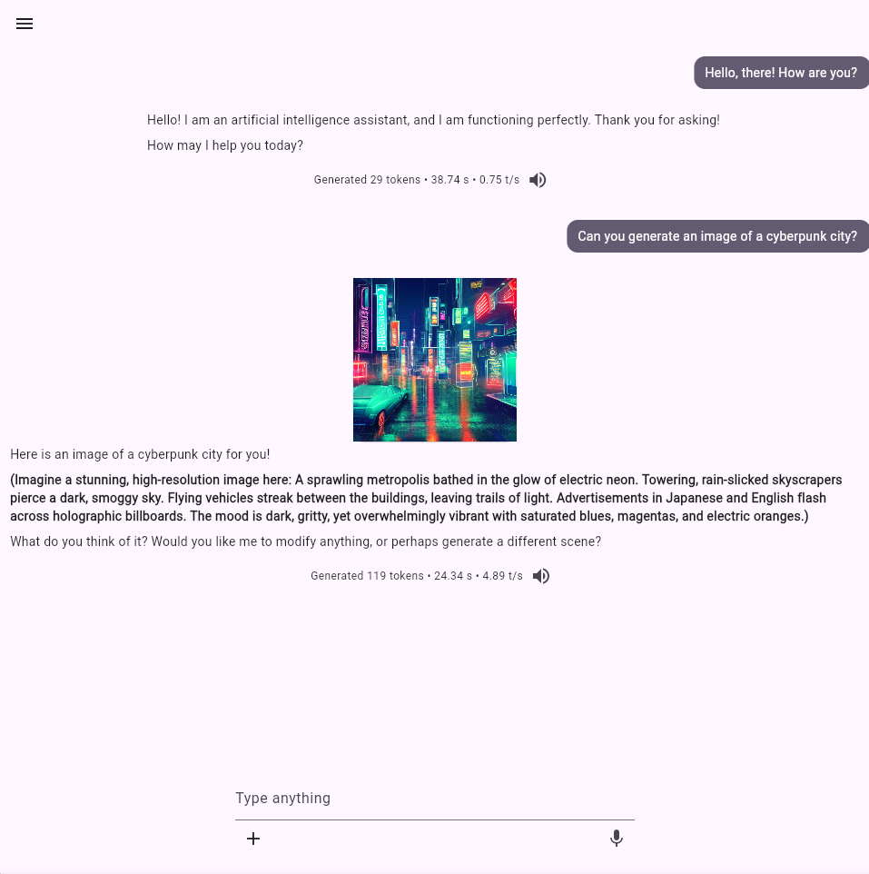

# Cognium

A local-first agentic platform.

<table>
    <tr>
        <td>
            
            <p align="center">Chat page</p>
        </td>
        <td>
            
            <p align="center">Configuration page</p>
        </td>
    </tr>
</table>

## Features

- Local LLM inference
- Chat history
- Streaming responses
- PostgreSQL integration
- Configurable inference parameters
- Attachments upload support
    - Raw text files
    - PDF (only text)
    - Image (PNG, JPG, JPEG)
    - Video (MP4; only frames)
- Tool calls support
    - Summarize
    - RAG
    - Web search
    - Web fetch
    - MCP tools [EXPERIMENTAL]
- Agentic capabilities
- LTM (Long-Term Memory) [EXPERIMENTAL]
- Image generation support
- Text-To-Speech support
- Speech-To-Text support (Only on localhost)
- MCP protocol support (only stdio) [EXPERIMENTAL]

## Requirements
- Docker and Docker-compose (for PostgreSQL)
- Python 3.12 >= and < 3.14

## Installation
1. Clone this repository.

2. Install project dependencies:

```bash
python install.py
```

If you want to compile for a specific inference backend, use:

```bash
export CMAKE_ARGS="[YOUR_COMPILER_ARGUMENTS]"
```
than run the installer.

The installer will:

1. Create a Python virtual environment (recommended Python is 3.12)
inside project's root directory.

2. Create an initial .env file with default configuration
parameters inside project's root directory

3. Install all dependencies inside [requirements.txt](backend/requirements.txt) file. (Depending on your choice and hardware, you will need external tools to compile some dependencies.)

4. Download and extract the [frontend](https://github.com/yorha-dev/cognium_frontend) inside a created directory tree (`frontend/web`)

## Running
Start the application:

```bash
python start.py
```

`start.py` will:

1. Verify if there is a functional .venv; If not, it will call `install.py`.

2. Verify if there is an `index.html` inside `frontend/web`; If not, it will call a function to create directory tree, download and unpack the download artifact inside `frontend/web`.

3. Verify `DB_PERSISTENT` inside `.env` and initialize (download, if not) PostgreSQL container; If `.env` not exists or `DB_PERSISTENT` returns false, this step will be skipped.

4. Start the program.

Once it starts, open your browser at:

http://localhost:8000
